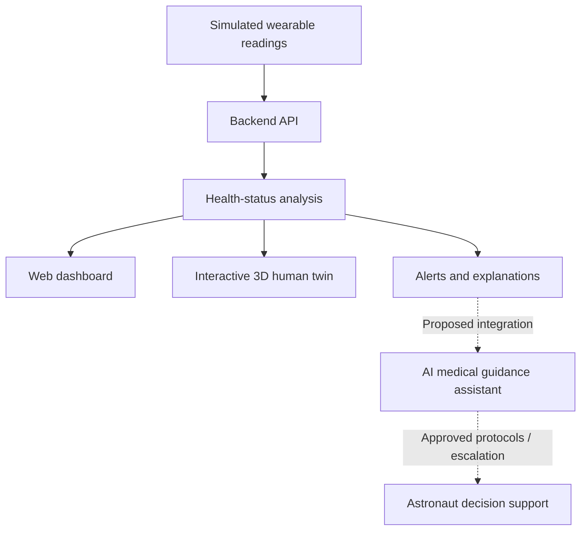

<div align="center">

# 🚀 AstroVitals
### Because Every Heartbeat Matters Beyond Earth

**AI-powered astronaut health monitoring, interactive visualization, and medical decision-support concept**

*NASA Space Apps Challenge 2026*

[Explore the Code](https://github.com/arouatlh/OR1.0)

</div>

---

## 🌌 The Challenge

**What happens when an astronaut experiences a medical emergency millions of kilometers from Earth—with no doctor immediately available?**

During deep-space missions, one-way communication delays between Mars and Earth can exceed 20 minutes. Astronauts may face physiological changes, isolation, limited medical supplies, and delayed expert support. Detecting an unusual vital sign is important—but knowing what to do next matters just as much.

## 💡 Our Solution

**AstroVitals** explores a future in which astronauts have access to a health-monitoring and AI-assisted decision-support platform designed for situations where medical expertise is not immediately available.

The project brings together simulated physiological data, health-status analysis, an interactive dashboard, a 3D human-body visualization, and a proposed conversational medical-guidance experience. Its central idea is to move **from simply displaying vital signs toward helping astronauts interpret risks and navigate appropriate next steps**.

> **Our mission:** No astronaut should face a medical emergency without guidance—even millions of kilometers from Earth.

## ✨ Core Capabilities

| Capability | Purpose |
| --- | --- |
| 📈 Vital-sign monitoring | Display physiological measurements from simulated wearable-sensor data. |
| 🚦 Health-risk indicators | Identify normal, elevated, and critical demonstration scenarios using transparent thresholds. |
| 🧍 Interactive 3D human twin | Visualize health information through an anatomical 3D interface; not a clinical scan. |
| 🤖 AI medical companion (concept / integration target) | Explain health information, ask symptom-related questions, and support accessible voice-based interaction. |
| 🆘 Emergency guidance (proposed) | Help users locate and follow approved onboard medical protocols while awaiting qualified assistance. |
| 🔁 Scenario simulation | Demonstrate changing readings, alerts, and recovery conditions without using real patient data. |

**Medical safety:** AstroVitals is a hackathon prototype and research concept, not a clinically validated diagnostic device or a substitute for a healthcare professional. AI-generated guidance must not be treated as authoritative emergency medical instructions. Real-world deployment would require medical oversight, validated protocols, extensive testing, and appropriate regulatory review.

## ⚙️ How It Works



1. **Generate data:** A simulator produces representative readings and predefined scenarios.
2. **Transmit readings:** The backend receives and processes physiological data.
3. **Assess status:** Demonstration logic highlights potential deviations from expected ranges.
4. **Visualize:** The frontend displays measurements and the 3D anatomical interface.
5. **Explain and support:** The envisioned AI assistant provides understandable explanations and, after medical validation, protocol-based guidance.

## 🧰 Technology Stack

The project uses a web frontend, backend services, and API testing resources. The team has also worked with the following technologies as part of the AstroVitals prototype and its development plan:

- **Frontend:** React, JavaScript, Three.js / React Three Fiber
- **Simulation and analytics:** Python, synthetic physiological scenarios
- **Integration:** HTTP APIs and JSON
- **API testing:** Postman
- **Collaboration:** Git and GitHub
- **Future integrations:** Voice-enabled AI assistant and compatible biomedical wearable devices

See the repository's source files for the exact dependencies and commands for each component.

## 📁 Repository Structure

```text
OR1.0/
├── astrovitals/                       # Frontend application
├── backend/                           # Backend services
└── AstroVitals.postman_collection.json # API testing collection
```

## 🚀 Getting Started

### 1. Clone the repository

```bash
git clone https://github.com/arouatlh/OR1.0.git
cd OR1.0
```

### 2. Set up the frontend

```bash
cd astrovitals
npm install
```

Check `astrovitals/package.json` for the available scripts and use the appropriate development command (commonly `npm run dev`).

### 3. Set up the backend

Open a separate terminal in `backend/`. Install the dependencies and start the service according to the backend's actual framework and configuration. **The exact backend startup command has not been verified in this README.**

### 4. Test API endpoints

Import `AstroVitals.postman_collection.json` into Postman and configure the base URL to match your local backend.

> **Configuration note:** Check the source for required environment variables, API keys, and service ports. Never commit credentials to GitHub.

## 🎬 Suggested Demo Walkthrough

1. Open the AstroVitals dashboard.
2. Start with a normal simulated health scenario.
3. Show physiological readings updating in the interface.
4. Switch to an elevated or critical scenario and highlight the status change.
5. Explore the 3D anatomical visualization.
6. If the AI assistant is integrated, demonstrate a non-clinical explanation of the alert and how the interface directs users toward approved procedures.
7. Return to a recovery scenario and show the status update.

*Only demonstrate features that are working in the submitted build.*

## 🌟 What Makes AstroVitals Different?

**The key innovation is the transition from detection to decision support.** A number on a dashboard may indicate a problem, but an astronaut far from Earth also needs understandable context and a safe path toward help.

AstroVitals combines:

- **Monitoring + interpretation:** Make readings understandable, not just visible.
- **3D visualization + data:** Present physiological information through an intuitive human-body interface.
- **Simulation + testing:** Explore risk scenarios without exposing real patient information.
- **AI + protocol-based support:** Investigate how a conversational assistant could help navigate medically approved procedures.
- **Autonomy + oversight:** Design for communication delays while recognizing the continuing importance of human medical experts.

## 🛡️ Design Priorities

- **Medical reliability:** Use medically reviewed protocols, clear uncertainty, and escalation pathways before any real deployment.
- **Communication delays:** Consider offline and low-connectivity operation for future missions.
- **Privacy:** Protect sensitive physiological information.
- **Usability:** Make urgent information understandable under stress.
- **Explainability:** Show why a simulated risk indicator was triggered.
- **Honest validation:** Distinguish demonstration thresholds and synthetic data from clinically validated predictions.

## 🔭 Future Roadmap

- [ ] Integrate compatible wearable sensors for real measurements.
- [ ] Validate health-risk models against appropriate clinical and aerospace-medical evidence.
- [ ] Implement a medically reviewed, retrieval-based protocol library.
- [ ] Add robust offline voice interaction and accessibility features.
- [ ] Develop astronaut-specific baseline and trend analysis.
- [ ] Evaluate the system with domain experts and simulated mission scenarios.

## 🌍 Potential Impact

AstroVitals envisions a future where astronauts can better understand their health and access reliable decision support despite long communication delays. With extensive validation, similar ideas may also benefit remote research stations and other isolated environments on Earth.

**We are not building an AI doctor. We are exploring how intelligent tools could help people make safer, more informed decisions when professional assistance is far away.**

---

<div align="center">

### 🚀 AstroVitals
**Because Every Heartbeat Matters Beyond Earth.**

*Built for the NASA Space Apps Challenge 2026*

</div>
